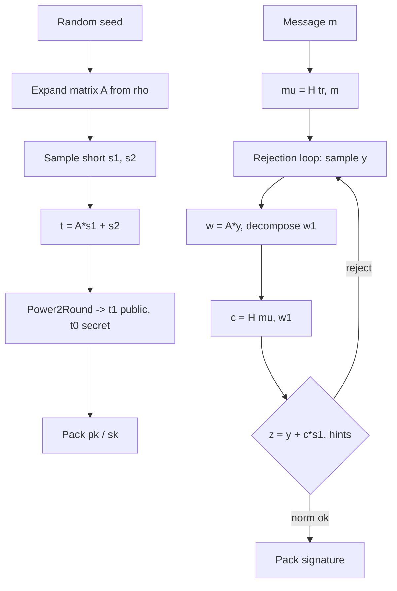

# CRYSTALS-Dilithium (ML-DSA-65) Library

A from-scratch educational implementation of **Dilithium3** (NIST **ML-DSA-65**), structured for clarity and comparison with lattice KEMs such as Kyber.

## What Dilithium Does

Dilithium is a **post-quantum digital signature** scheme. Security rests on the hardness of Module-LWE / Module-SIS over polynomial rings \(\mathbb{Z}_q[X]/(X^{256}+1)\) with \(q = 8380417\).

| Object | Role |
|--------|------|
| **Public key** | Seed \(\rho\) + compressed vector \(t_1\) |
| **Secret key** | Short vectors \(s_1, s_2\), low part \(t_0\), hashes |
| **Signature** | Challenge \(c\), response \(z\), hints \(h\) |

## High-Level Flow



### Key generation

1. Draw random \(\rho, \rho'\), signing key `key`.
2. Expand public matrix \(A \in \mathbb{Z}_q^{K \times L}\) from \(\rho\) via SHAKE128.
3. Sample secret vectors \(s_1, s_2\) with coefficients in \([-4,4]\).
4. Compute \(t = A s_1 + s_2\), split \(t = t_1 \cdot 2^D + t_0\).
5. Public key: \((\rho, t_1)\). Secret key adds \(t_0, s_1, s_2\), and \(tr = H(pk)\).

### Signing (Fiat–Shamir with aborts)

1. Hash message: \(\mu = H(tr \,\|\, m)\).
2. Derive \(\rho' = H(key \,\|\, rnd \,\|\, \mu)\).
3. Sample masking vector \(y\); set \(w = A y\).
4. Decompose \(w \to (w_1, w_0)\); challenge \(c = H(\mu \,\|\, \mathrm{pack}(w_1))\).
5. Compute \(z = y + c s_1\); reject if \(\|z\|_\infty \ge \gamma_1 - \beta\).
6. Adjust low bits using \(s_2, t_0\); build hint vector \(h\) (weight \(\le \omega\)).
7. Output \((c, z, h)\).

### Verification

Recompute \(w_1'\) from \(A z - c \cdot 2^D t_1\) and hints; check \(H(\mu \,\|\, w_1') = c\).

## Build

```bash
cmake -B build -DCMAKE_BUILD_TYPE=Release
cmake --build build
ctest --test-dir build
```

Windows (Visual Studio):

```powershell
cmake -B build
cmake --build build --config Release
.\build\Release\test_verify.exe
```

## Layout

```
include/dilithium/   Public API & parameters
src/                 Reference implementation (Keccak, NTT, sign, …)
tests/               Keygen, sign, verify, benchmark
examples/            Minimal sign/open demo
docs/architecture.md Kyber vs Dilithium module map
```

## Sizes (Dilithium3)

| | Bytes |
|---|------:|
| Public key | 1952 |
| Secret key | 4032 |
| Signature | 3309 |

## API

```c
#include "dilithium/dilithium.h"

crypto_sign_keypair(pk, sk);
crypto_sign_signature(sig, &siglen, msg, mlen, sk);
crypto_sign_verify(sig, siglen, msg, mlen, pk);
crypto_sign(sm, &smlen, msg, mlen, sk);      /* attached signature */
crypto_sign_open(m, &mlen, sm, smlen, pk);
```

## References

- [CRYSTALS-Dilithium](https://pq-crystals.org/dilithium/)
- [FIPS 204 (ML-DSA)](https://csrc.nist.gov/pubs/fips/204/final)
