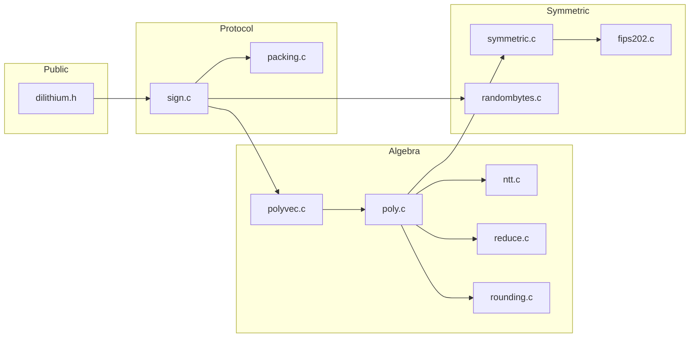

# Architecture: Kyber vs Dilithium

This document maps modules between a typical **Kyber (ML-KEM)** stack and this **Dilithium (ML-DSA)** library.

## Purpose

| | Kyber | Dilithium |
|---|--------|-----------|
| Primitive | Key encapsulation (KEM) | Digital signature |
| Hard problem | Module-LWE | Module-LWE + Module-SIS |
| \(q\) | 3329 | 8380417 |
| \(N\) | 256 | 256 |
| Dimensions | \(k=3\) (Kyber768) | \(K=6, L=5\) (Dilithium3) |

## Module correspondence

```
Kyber                          Dilithium (this repo)
─────────────────────────────────────────────────────────
params.h                       include/dilithium/params.h
api.h / kem.h                  include/dilithium/dilithium.h
indcpa.c (CPA layer)           sign.c (Fiat–Shamir + packing)
poly.c / polyvec.c             src/poly.c, src/polyvec.c
ntt.c / reduce.c               src/ntt.c, src/reduce.c
cbd.c (noise)                  poly_uniform_eta (in poly.c)
symmetric.c + fips202.c        src/symmetric.c, src/fips202.c
verify.c                       src/verify.c (same role)
randombytes.c                  src/randombytes.c
```

## Layered stack

```text
┌─────────────────────────────────────────┐
│  dilithium.h  — crypto_sign_* API       │
├─────────────────────────────────────────┤
│  sign.c       — KeyGen, Sign, Verify    │
│  packing.c    — pk, sk, sig bytes       │
├─────────────────────────────────────────┤
│  polyvec.c    — matrix A, vector ops    │
│  poly.c       — ring ops, sampling      │
├─────────────────────────────────────────┤
│  ntt.c, reduce.c, rounding.c            │
├─────────────────────────────────────────┤
│  symmetric.c, fips202.c, randombytes.c  │
└─────────────────────────────────────────┘
```

## What is reused unchanged

- **Keccak / SHAKE** (`fips202.c`): identical sponge core; domain separation differs (matrix indices vs nonces).
- **NTT pipeline**: same butterfly structure; different modulus constants in `reduce.c` / `ntt.c`.
- **Constant-time compare** (`verify.c`): byte comparison for challenge check.
- **OS RNG** (`randombytes.c`): platform CSPRNG.

## What differs fundamentally

| Concern | Kyber | Dilithium |
|---------|--------|-----------|
| Rounding | Compress u, v for ciphertext | `power2round`, `decompose`, hints |
| Oracle | Hash of ciphertext | Hash of high bits \(w_1\) |
| Retry loop | None (encryption) | Rejection sampling on \(\|z\|\), hints |
| Output | Shared secret | Signature \((c,z,h)\) |

## Sampling

| Kyber | Dilithium |
|-------|-----------|
| Centered binomial \(\eta=2\) | Uniform \(\eta=4\) for secrets |
| — | `poly_uniform` for matrix \(A\) |
| — | `poly_uniform_gamma1` for mask \(y\) |
| — | `poly_challenge` for sparse \(c\) |

## File split in this project

The original plan listed separate `sampling.c`, `challenge.c`, and `decompose.c`. For maintainability they are folded into:

- `poly.c` — uniform / eta / gamma1 sampling, challenge, serialization
- `rounding.c` — `decompose`, `power2round`, hints

`sign.c` was the main missing protocol layer; it wires these pieces into the NIST API.

## Build graph


